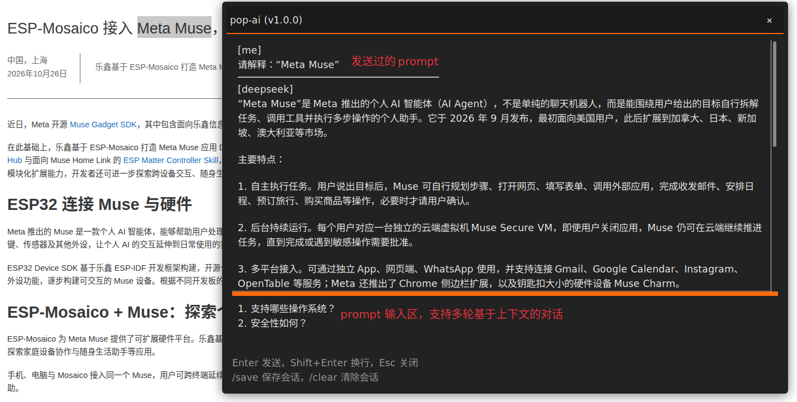

# pop-ai

按下快捷键即可弹出 AI 对话框，随时提问，无需在软件间切换，帮助你保持专注、减少分心，并支持多轮上下文对话。

## 环境要求

Ubuntu 22.04/24.04，Xorg 会话登录，Python 3.10 ～ 3.15，GNOME 桌面。当前会话用下面的命令确认，输出应为 `x11`：

```bash
echo "$XDG_SESSION_TYPE"
```

## 安装依赖

在仓库目录执行：

```bash
sudo apt install python3-gi gir1.2-gtk-3.0 python3-xlib xdotool xclip
```

## 配置

- 默认模型为 DeepSeek 的 `deepseek-flash`。请前往 [DeepSeek](https://platform.deepseek.com/api_keys) 平台获取 API key，并保存到 ~/.pop-ai/deepseek_key。此项为必填，必须配置。
- 可选配置位于 `config.toml`，按需调整。

## 注册快捷键

```bash
chmod +x ./pop-ai
./pop-ai install-shortcuts
```

- 默认快捷键为 Super+P。如需替换，先修改 `config.toml`，再运行上面命令。
- Super+P 快捷键若被占用，例如切换显示器，则会弹出对话框由用户决定是否替换该快捷键。

## 使用

任何地方，按 Super+P 和 AI 即时对话。

## 界面


